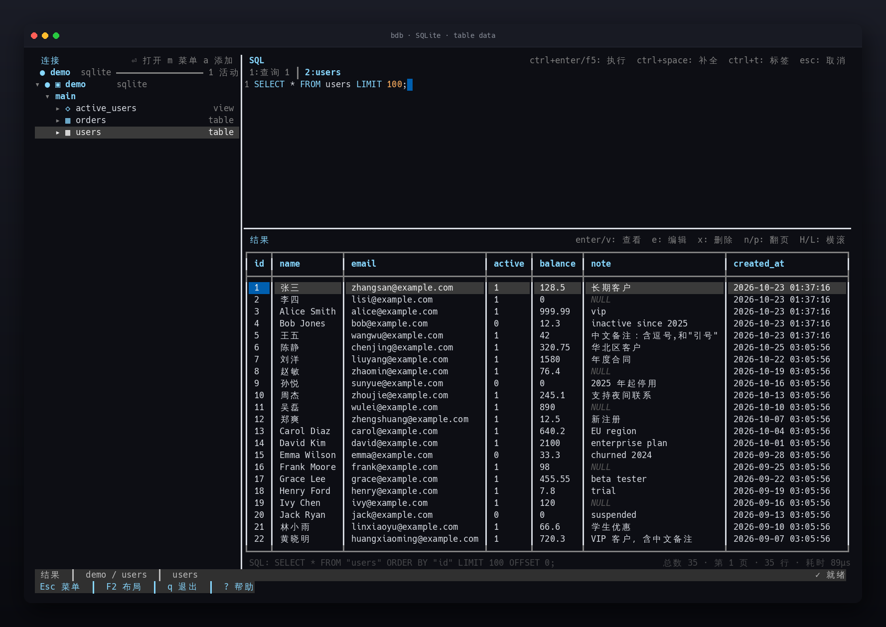
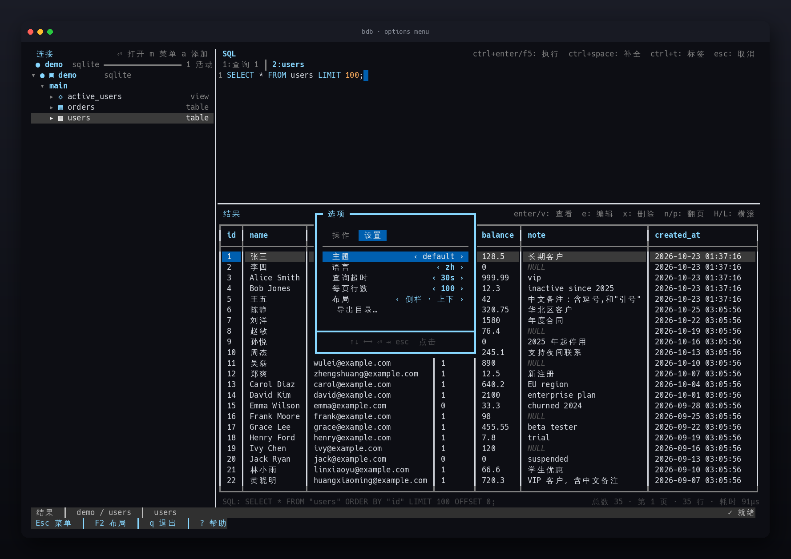
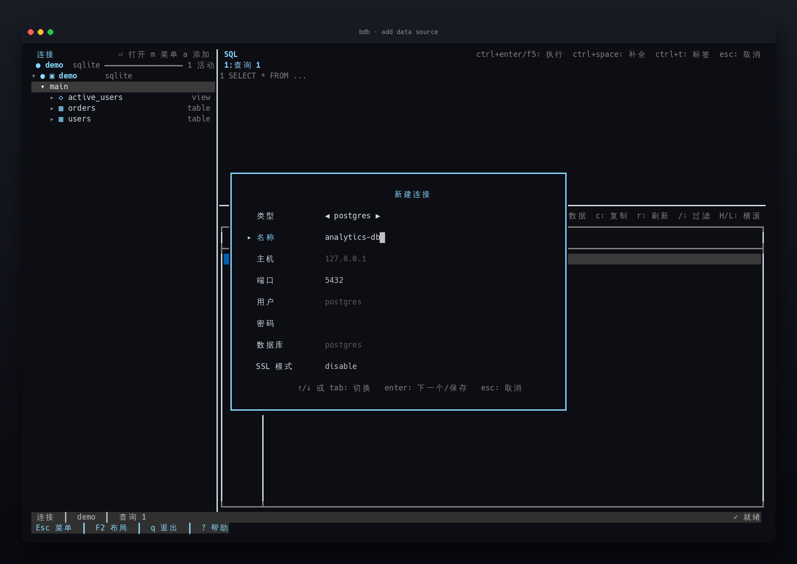
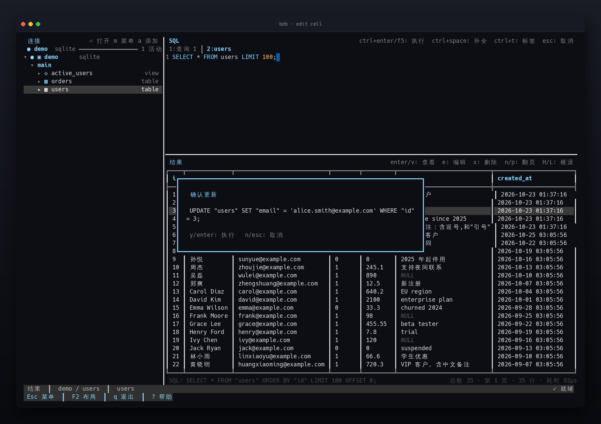
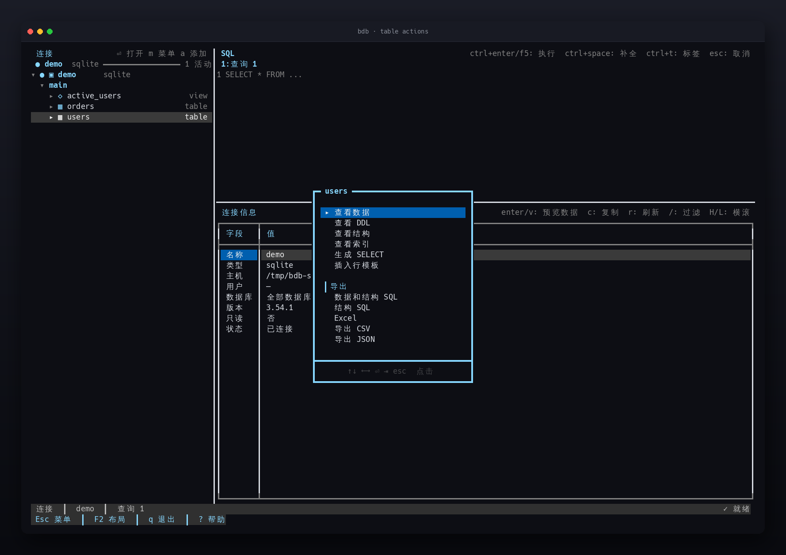
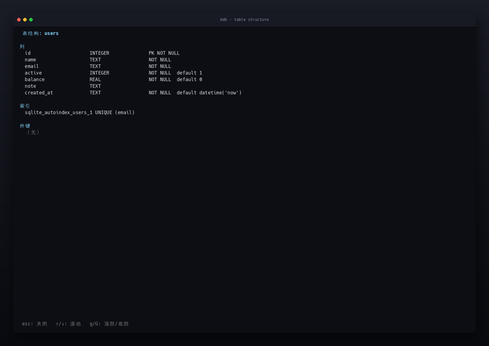
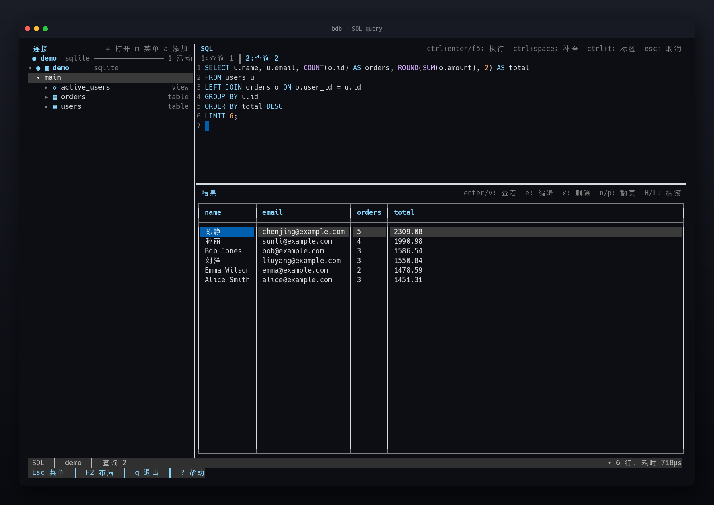
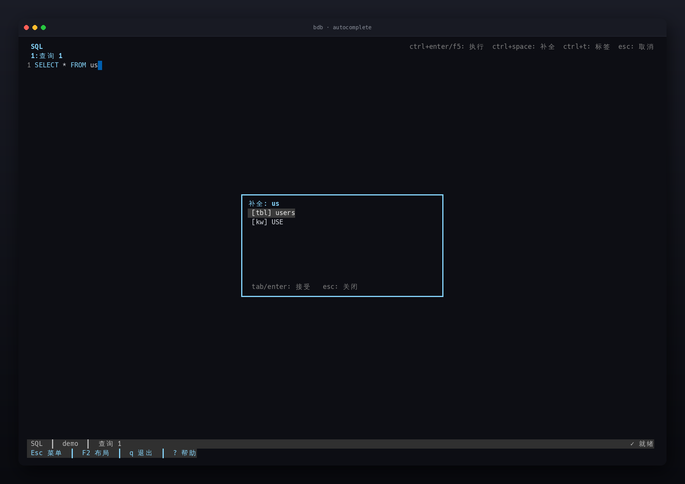
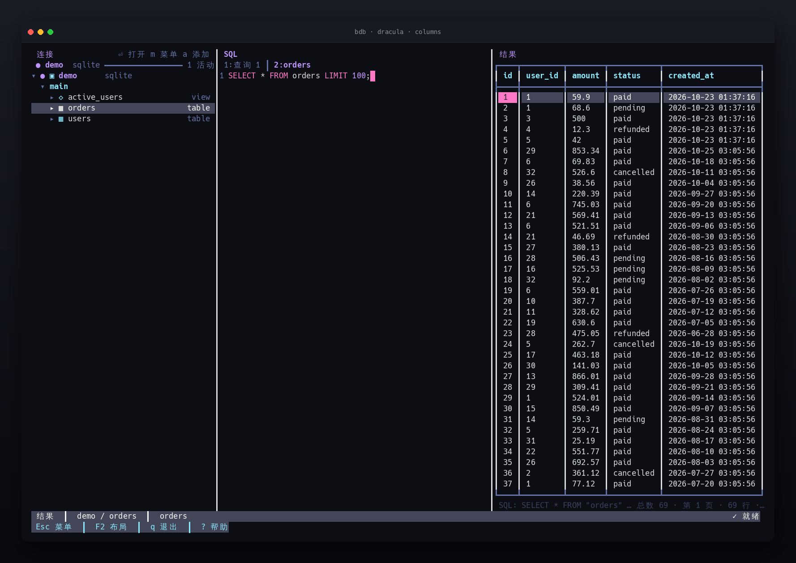

# bdb

[English](README.en.md) | **简体中文**

一款面向 Linux 终端的现代化数据库管理工具，使用 Go + [Bubble Tea v2](https://github.com/charmbracelet/bubbletea) 构建。目标是在一个终端窗口内完成连接管理、库表浏览、SQL 编辑执行、数据编辑与导出。

已完成：PostgreSQL/MySQL/SQLite 浏览与查询、事务化数据编辑、Redis/MongoDB、多会话、表结构/DDL/索引、CSV/JSON/Markdown 导出、SQL 文件执行、查询历史、6 套主题、SQL 语法高亮与自动补全、专注布局与鼠标操作。

## 界面预览



连接后在侧栏浏览库表，在编辑器中写 SQL 并执行，结果以可编辑的网格展示。下文各章节还会给出对应的真实运行截图。

## 安装

要求 Go 1.26+。

### go install

```bash
go install github.com/LinduanTof/b-db/cmd/bdb@latest
```

安装指定版本：

```bash
go install github.com/LinduanTof/b-db/cmd/bdb@v0.3.0
```

二进制默认安装到 `$(go env GOPATH)/bin`（设置了 `GOBIN` 时使用该目录）。确保它在 `PATH` 中：

```bash
export PATH="$(go env GOPATH)/bin:$PATH"
bdb --version
```

### 从源码构建

```bash
make demo-db     # 生成 SQLite 示例库 testdata/demo.db
make build       # 输出 bin/bdb
```

## 快速开始

```bash
bdb --config config.example.yaml            # go install 安装的二进制
./bin/bdb --config config.example.yaml      # 从源码构建的二进制
```

默认配置文件路径为 `$XDG_CONFIG_HOME/bdb/config.yaml`（通常是 `~/.config/bdb/config.yaml`），可用 `--config` 覆盖。首次启动时若文件不存在，会自动创建一份带注释的默认模板（权限 `0600`），不会覆盖已有文件。

配置文件最小示例：

```yaml
ui:
  language: auto          # auto | en | zh
  theme: default          # default | dracula | gruvbox | nord | catppuccin | solarized-light
  focus_mode: manual      # manual | auto
  layout: stacked         # stacked | columns | results-top
  export_dir: ""          # 导出目录；留空为当前工作目录
query:
  timeout: 30s            # unlimited 表示禁用客户端超时
  max_rows: 1000          # 表数据浏览每页行数；编辑器查询不限制
connections:
  - name: local
    type: sqlite
    path: ./testdata/demo.db
  - name: pg
    type: postgres
    host: 127.0.0.1
    port: 5432
    user: postgres
    password: ${PG_PASSWORD}
    database: postgres
    sslmode: disable
  - name: mysql
    type: mysql
    host: 127.0.0.1
    port: 3306
    user: bdb
    password: ${MYSQL_PASSWORD}
    database: bdb
```

`password` 等字段支持 `${ENV_VAR}` 引用；变量未设置时启动会报错并指出连接名与字段，不会静默使用空字符串。建议 `chmod 600` 配置文件。PostgreSQL 的 `database` 可省略，省略时连接到 `postgres` 库，连上后仍可在侧栏浏览所有数据库。`query.timeout` 设为 `unlimited`（或在 `Esc` 选项菜单选择「Unlimited」）会禁用客户端查询超时，查询只能手动取消；连接建立超时仍为 10 秒。

## 快捷键

| 范围 | 按键 | 作用 |
|---|---|---|
| 全局 | `Esc` | 打开选项菜单；查询执行中为取消查询 |
| 全局 | `F2` | 切换专注布局（当前面板全屏） |
| 全局 | `Ctrl+Shift+W` / `Alt+W` | 关闭当前数据库会话，其他会话保留 |
| 全局 | `q` | 退出（编辑器焦点下输入字符） |
| 全局 | `?` | 打开快捷键帮助 |
| 全局 | `Tab` / `Shift+Tab` | 切换面板 |
| 全局 | `Ctrl+C` | 退出 |
| 连接 | `↑` / `↓` | 移动光标 |
| 连接 | `Enter` | 连接、展开节点；表节点打开表（新建或复用标签）；已连接的连接根显示连接信息 |
| 连接 | `→` / `←` | 展开 / 折叠 |
| 连接 | `m` | 打开节点操作菜单（连接、数据库、表） |
| 连接 | `s` | 快速预览表数据（不修改编辑器） |
| 连接 | `o` | 在编辑器中打开表，不自动执行 |
| 连接 | `d` | 查看表结构（列/索引/外键） |
| 连接 | `a` | 添加数据源（侧栏/结果焦点） |
| 连接 | `r` | 重新加载当前节点 |
| 编辑器 | `Ctrl+Enter` / `F5` | 执行 SQL |
| 编辑器 | `Ctrl+T` | 新建 SQL 标签 |
| 编辑器 | `Ctrl+W` | 关闭当前 SQL 标签（最后一个标签不可关闭） |
| 编辑器 | `Ctrl+Tab` / `Ctrl+Shift+Tab` | 下一个 / 上一个标签 |
| 编辑器 | `Alt+←` / `Alt+→` | 切换标签（终端不支持 `Ctrl+Tab` 时使用） |
| 编辑器 | `Ctrl+Space` | 手动触发 SQL 补全 |
| 编辑器 | `Ctrl+P` / `Ctrl+N` | 查询历史 |
| 编辑器 | `Esc` | 取消正在执行的查询 |
| 结果 | 方向键 / `hjkl` | 移动单元格 |
| 结果 | `n` / `p` | 下一页 / 上一页（表数据分页） |
| 结果 | `PgUp` / `PgDn` | 翻页 |
| 结果 | `g` / `G` | 首行 / 末行 |
| 结果 | `H` / `L` | 向左 / 向右翻一屏列 |
| 结果 | `Enter` / `v` | 查看当前单元格的完整内容 |
| 结果 | `e` | 编辑当前单元格 |
| 结果 | `x` | 删除当前行 |
| 结果 | `[` / `]` | 减小 / 增大当前列宽 |
| 结果 | `o` / `O` | 按当前列排序（升/降）/ 清除排序 |
| 结果 | `r` | 刷新当前数据库的表概览 |
| 结果 | `/` | 过滤表概览（按 schema、表名、类型） |
| 结果 | `c` | 复制当前单元格（OSC 52） |
| 结果 | `Ctrl+E` / `Ctrl+J` / `Ctrl+M` | 导出 CSV / JSON / Markdown |

> 普通终端通常无法区分 `Ctrl+Enter` 与 `Enter`。bdb 会请求终端的键盘增强协议（Kitty protocol）；若终端不支持，请使用 `F5` 执行。

## 选项菜单

按 `Esc` 打开 btop 风格的选项菜单（主界面保留在背景中）：

- `↑`/`↓` 移动选项，`←`/`→` 调整设置值，`Enter` 执行操作，`Esc` 关闭
- `Tab` / `Shift+Tab` 在「操作」和「设置」两个标签页之间切换，也可直接点击标签
- 菜单采用 btop 风格：粗线边框、标题嵌入边框、标签页、选中行整行色块
- 操作页：添加数据源、断开连接、帮助、退出
- 设置页：主题、界面语言、查询超时（含不限）、表数据每页行数、整体布局、导出目录，修改即时生效
- 导出当前结果使用结果面板的 `Ctrl+E` / `Ctrl+J` / `Ctrl+M`，不再重复出现在菜单中
- 底部菜单栏常驻显示 `Esc 菜单`、`q 退出`、`? 帮助`

菜单打开时按 `q` 可直接退出。



*选项菜单分为「操作」与「设置」两个标签页，主题、语言、超时、分页、布局和导出目录修改后立即生效。*

## SQL 文件执行

启动时传入脚本会在连接默认连接后自动执行，最后一条查询的结果显示在结果面板：

```bash
./bin/bdb --config config.yaml ./migrations/001_init.sql
```

脚本按分号切分，支持单引号/双引号/反引号字符串、`--`、`/* */` 注释；MySQL 下支持 `#` 注释与 `DELIMITER`，PostgreSQL 下支持 `$tag$...$tag$` dollar-quoting 并保留 `#` 运算符。任一语句失败会停止并报告语句序号。执行期间可按 `Esc` 取消。

## 添加数据源

在侧栏或结果面板按 `a`，或从选项菜单选择“添加数据源”，打开居中的大尺寸连接表单。用 `←`/`→` 选择 PostgreSQL、MySQL、SQLite、Redis 或 MongoDB，`↑`/`↓` 或 `Tab` 切换字段，`Enter` 在最后一个字段保存，`Esc` 取消。

- 密码字段以掩码显示；也可以填写 `${ENV_VAR}` 引用环境变量。
- 保存后会自动建立连接，新数据源立即出现在侧栏。
- 运行时添加的连接保存在 `$XDG_STATE_HOME/bdb/connections.yaml`（权限 `0600`），启动时与主配置合并；同名连接不会重复添加。
- 字段会根据类型动态变化：SQLite 只需要名称与路径；MySQL 与 Navicat 一样不需要填写数据库名；Redis 填写地址、密码与数据库编号；MongoDB 填写连接 URI。
- 表单内容居中展示，label 固定宽度左对齐；当前字段以 `▸` 标记并在底部显示操作提示。



*表单字段随类型变化，密码以掩码显示，保存后立即连接并出现在侧栏。*

## 布局

- `stacked`（默认）：侧栏 + 右侧编辑器在上、结果在下
- `columns`：侧栏、编辑器、结果三栏并排；终端过窄时自动回退为 `stacked`
- `results-top`：侧栏 + 右侧结果在上、编辑器在下
- 在 `Esc` 选项菜单的“布局”一项中切换，立即生效并记住选择；也可用 `ui.layout` 配置默认值

## 专注布局

- 按 `F2` 让当前焦点面板占满主区域，再按一次恢复三栏
- 专注模式下 `Tab` 保持在三个全屏面板之间切换，不会退回三栏
- 侧栏同样支持全屏，方便浏览大量表和字段
- 配置 `ui.focus_mode: auto` 后，编辑器与结果面板会自动跟随焦点全屏，侧栏焦点时恢复三栏；此时 `F2` 用于暂停或恢复自动专注
- 选项菜单中也可选择 “Toggle focused layout”

## 鼠标

- 点击侧栏节点：连接、展开或激活节点
- 菜单打开时：首次点击选中条目，再次点击已选中的条目才执行动作或切换选项；点击标签切换「操作/设置」页，滚轮移动选中项，点击菜单外部关闭
- 表节点：单击只选中，双击打开表（新建或复用标签并加载分页数据）；节点操作菜单用键盘 `m`
- 点击编辑器或结果面板：切换焦点
- 点击结果单元格：选中对应单元格
- 滚轮：在侧栏、结果网格、DDL/索引查看器中滚动

## 侧栏会话状态

侧栏顶部显示当前连接、数据库类型和活动会话数量，并用状态点区分连接状态：

- `●`：当前活动连接
- `◉`：已打开但当前未显示的会话
- `○`：尚未连接的配置
- 连接名、数据库类型按列对齐；表显示 `▦`，视图显示 `◇`
- 左侧栏标题右上角显示常用快捷键：`⏎` 打开、`m` 表操作菜单、`s` 预览表数据、`d` 表结构、`r` 重新加载、`a` 添加数据源；宽度足够时显示文字说明
- `↑`/`↓` 只移动光标，不加载任何内容；`Enter` 才激活节点
- `m` 打开当前节点的操作菜单：连接提供连接/连接信息/刷新/断开，数据库提供打开/刷新/关闭会话，表提供数据预览、DDL、结构、索引与生成 SELECT
- 断开连接会关闭该连接下的所有库会话并折叠连接列表；关闭会话会收起对应的数据库节点
- 连接根激活后在结果面板显示连接信息（主机、用户、数据库、服务端版本、只读、连接状态）；数据库节点激活后显示该库的表概览（表名、类型、行数估算、大小、列数、注释），在结果面板按 `r` 刷新、按 `/` 过滤。表概览只选择整行，按 `Enter` 或 `v` 打开所选表的数据预览。PostgreSQL/SQLite 额外显示 Schema 列；MySQL/MongoDB 的数据库本身即 schema，不再重复显示
- PostgreSQL、MySQL、MongoDB 连接节点展开后会列出所有可连接的数据库；每个数据库都是独立会话
- PostgreSQL 的数据库下显示 schema，再显示表；MySQL/MongoDB 的数据库节点直接显示表或集合
- 数据库列表在切换到其他连接后仍会保留；点击连接根只展开/折叠列表并显示连接信息，点击具体数据库才连接并切换
- 会话切换会恢复上次的面板内容、表概览过滤词和侧栏光标位置；切回仍停留在概览的会话时会自动刷新表列表
- SQLite 以 `main` schema 为一级节点；Redis 仍按 db/key 浏览
- 展开节点使用 `▸` / `▾`，列字段使用 `·`

## 结果网格

- 字段较多时，`←`/`→` 移动单元格会自动横向滚动；`H`/`L` 直接向左/右翻一屏列，`Home`/`End` 跳到首列/末列
- 单元格内容超过列宽时仍会截断显示；选中后按 `Enter` 或 `v` 打开完整内容查看器
- 查看器支持 `↑`/`↓`、`PgUp`/`PgDn`、`g`/`G` 滚动，`Esc` 或 `q` 关闭
- `[`/`]` 调整当前列宽，`o`/`O` 排序，`c` 复制单元格；导出会遵循当前排序
- 通过「View data」打开的表数据支持服务端分页：`n` 加载下一页，`p` 返回上一页；每页大小取 `query.max_rows`，表有主键时按主键稳定排序
- 表数据预览会在结果表格下方以一行淡色显示 SQL、总行数、页码、当前页行数和查询时间；空间不足时优先截断 SQL 并保留统计信息
- 分页查询只在结果面板进行，不会修改编辑器内容；单元格编辑或删除后会刷新当前页，不会跳回第一页
- 客户端排序（`o`/`O`）只作用于当前页；表数据预览中的 `o`/`O` 会改用数据库 `ORDER BY` 重新查询，排序对所有页生效并回到第一页
- 表概览的行数与大小是估算值（PostgreSQL `reltuples`/`pg_total_relation_size`，MySQL `information_schema`）；表注释来自 PostgreSQL `obj_description` 或 MySQL `TABLE_COMMENT`。无法获取时显示 `-`，SQLite、Redis、MongoDB 不提供行数、大小与注释

## 导出表与数据库

在表或数据库节点按 `m`，菜单的「导出」区提供五种格式：

- 数据和结构 SQL：`CREATE` DDL 加逐行 `INSERT`，可用于重建表
- 结构 SQL：仅 DDL
- Excel（`.xlsx`）：表级一个工作表；数据库级每个表一个工作表
- CSV：表级单个文件；数据库级输出到目录，每表一个文件
- JSON：表级为对象数组；数据库级为 `{ "schema.table": [...] }`

文件写入导出目录，默认是启动时的工作目录。可在 `Esc` 选项菜单的「Export directory」中修改：输入绝对路径或相对路径（相对当前工作目录），留空恢复为当前工作目录；目录不存在时会自动创建。选择保存在 `$XDG_STATE_HOME/bdb/export_dir`，也可用配置 `ui.export_dir` 设置默认值。命名为 `bdb-<名称>-<时间戳>.<扩展名>`。导出使用流式游标逐行读取并写入磁盘，内存占用与表大小无关（不会把整表载入内存）；状态栏实时显示当前表与进度（库级显示表计数，单表每 10 万行更新一次行数），完成后显示路径。导出总超时为 30 分钟。Excel 单个工作表最多 1,048,575 行，超出会报错，请改用 CSV 或 SQL。导出仅适用于 PostgreSQL、MySQL 和 SQLite；Redis 与 MongoDB 的节点菜单不显示导出项。

## 数据编辑

仅当结果通过「表操作菜单 → View data」打开、且表有主键时启用：

- `e` 编辑当前单元格：输入新值 → 预览 `UPDATE` SQL → `y` 确认执行
- `x` 删除当前行：预览 `DELETE` SQL → `y` 确认执行
- 写入在事务中执行，影响行数必须为 1
- 在分页表数据中编辑或删除后，会重新加载当前页
- 连接配置 `read_only: true` 时禁止单元格编辑和 SQL 写入语句，并额外拦截：SQL 的 `EXECUTE`、SQLite 的写入型 `PRAGMA`；Redis 中只放行常见只读命令，其余（含 `EVAL`/`FCALL`、`SETBIT`、`SORT ... STORE` 等）一律拒绝；MongoDB 的 `$out`、`$merge`、`$where`、`$function`、`$accumulator` 一律拒绝。这是保守的客户端检查，仍建议使用数据库只读账号或只读副本作为真正的安全边界。
- 表操作菜单的「Insert row template」会生成 `INSERT` 模板到编辑器



*按 `e` 修改单元格，回车后先预览完整 `UPDATE` 语句，确认时才在事务中执行。*

## Redis 与 MongoDB

Redis：

- 侧栏按 db → key 浏览（SCAN，最多 500 个键）
- 表操作菜单 View data 会按 key 类型生成 `GET` / `HGETALL` / `LRANGE` / `SMEMBERS` / `ZRANGE` / `XRANGE`
- 编辑器可直接输入 Redis 命令，如 `SCAN 0 COUNT 50`、`GET "my key"`

MongoDB：

- 侧栏按 database → collection 浏览
- 编辑器查询语法：
  - `find <db>.<collection> [json]`
  - `findOne <db>.<collection> [json]`
  - `aggregate <db>.<collection> [json array]`
  - `count <db>.<collection> [json]`
- 表操作菜单 View data 会生成 `find db.collection {}`

## 多会话

每个连接作为独立会话保留编辑器内容、结果网格、补全与编辑缓存。在侧栏切换到另一个配置连接时自动保存当前状态，切回时恢复；断开当前连接不会影响其他会话。

SQL 标签也按连接隔离：每个会话保存自己的标签列表和活动标签，切换连接时一起恢复。标签内容会自动持久化到 `$XDG_STATE_HOME/bdb/editor_tabs.yaml`，应用重启后连接时恢复。

关闭会话：

- `Esc` →「关闭当前会话」只释放当前数据库会话，其他连接/数据库会话继续保留
- 也可按 `Ctrl+Shift+W` 或 `Alt+W` 直接关闭当前会话
- 切换连接或数据库不会关闭会话，只会保存当前状态
- `q` 或 `Ctrl+C` 退出程序时会关闭全部会话和连接

## 表操作菜单

在侧栏选中表后按 `Enter` 打开：

- **View data**：按 `query.max_rows` 分页浏览表数据，不改动编辑器；结果面板可用 `n`/`p` 翻页
- **View DDL**：查看建表语句（MySQL 使用 `SHOW CREATE TABLE`，SQLite 读取 `sqlite_master`，PostgreSQL 根据 catalog 生成）
- **View structure**：列、索引、外键详情
- **View indexes**：索引列表
- **Generate SELECT**：只生成查询填入编辑器，不执行

DDL 与索引查看器支持 `↑`/`↓`、`PgUp`/`PgDn`、`g`/`G` 滚动，`Esc` 或 `q` 关闭。



*表操作菜单提供数据预览、DDL、结构、索引、生成 SELECT、插入行模板以及 SQL/Excel/CSV/JSON 导出。*



*`View structure` 列出列类型、主键、非空、默认值、索引与外键，可用 `g`/`G` 快速跳到顶部或底部。*

## SQL 编辑器

编辑器会按当前主题为 SQL 着色：关键字、函数、字符串、数字与注释分别使用不同颜色。支持多行编辑、行号、`Ctrl+Space` 自动补全与查询历史。

编辑器查询不限制返回行数，结果会一次性载入内存；查询大表时请自行加 `LIMIT`。`query.max_rows` 只控制表数据浏览的分页大小。



*关键字、字符串、数字与注释分别着色；`F5` 或 `Ctrl+Enter` 执行，结果网格支持排序、复制与导出。*

## 底部状态栏

- 左侧显示当前面板、面包屑和活动 SQL 标签，例如 `Results │ local-sqlite / users │ Query 1`
- 面包屑为 `连接 / 数据库 / schema.table`，表数据或编辑器标签来自具体表时会补全到表名
- 当前连接、数据库类型和活动会话数显示在左侧栏顶部
- 右侧显示带图标的状态提示：`✓ Ready`、`… Running`、`✗ error`
- 表数据分页的页码、行数和耗时显示在结果页脚，状态栏不再重复
- 最底部一行保留 `Esc`、`F2`、`q`、`?` 等快捷入口

## 多标签与自动保存

- 每个连接拥有独立的 SQL 标签组，切换连接时整套标签一起切换
- `Ctrl+T` 新建、`Ctrl+W` 关闭、`Ctrl+Tab` / `Ctrl+Shift+Tab` 或 `Alt+←/→` 切换
- 标签内容、标题和当前活动标签会自动保存到 `$XDG_STATE_HOME/bdb/editor_tabs.yaml`（权限 `0600`），重启并连接后恢复
- 最后一个标签不能关闭，避免编辑器没有可用标签

## SQL 自动补全

在编辑器中输入标识符时会自动弹出候选，也可按 `Ctrl+Space` 手动触发。候选包括 SQL 关键字、常用函数、当前连接的所有表名，以及已加载的列名；输入 `users.` 时会按需加载该表的列。`↑`/`↓` 选择，`Tab` 或 `Enter` 接受，`Esc` 关闭。



*在专注布局（`F2`）下输入标识符并触发 `Ctrl+Space`，候选会标注来源（表名、关键字）。*

## 主题

内置 6 套主题：`default`、`dracula`、`gruvbox`、`nord`、`catppuccin`、`solarized-light`。可在配置文件中设置 `ui.theme`，或按 `Esc` 打开选项菜单后用 `←`/`→` 切换。运行时选择会写入 `$XDG_STATE_HOME/bdb/theme`，下次启动自动恢复；该状态文件优先于 `ui.theme`，若想改回配置文件中的主题，请先删除此状态文件。



*`dracula` 主题下的 `columns` 三栏布局：侧栏、编辑器与结果并排，终端过窄时自动回退为 `stacked`。*

## 查询历史

成功执行的语句会持久化到 `$XDG_STATE_HOME/bdb/history`（默认 `~/.local/state/bdb/history`），文件权限为 `0600`，最多保留 500 条。编辑器内用 `Ctrl+P` / `Ctrl+N` 浏览。

## 开发

分支策略：

- `main` 只接受合并，不直接提交
- 日常开发在 `dev` 分支进行

```bash
make test        # 生成 demo.db 并运行全部测试
make vet
go test ./...
```

PostgreSQL / MySQL 集成验证：

```bash
docker compose -f deploy/docker-compose.yml up -d
PGPASSWORD=bdb psql -h 127.0.0.1 -U bdb -d bdb
mysql -h 127.0.0.1 -ubdb -pbdb bdb
```

若本地端口已被占用，可用环境变量覆盖：`BDB_PG_PORT=5433 BDB_MYSQL_PORT=3307 docker compose ... up -d`。

性能基准：

```bash
go test -bench . -benchmem ./internal/ui/results ./internal/ui/editor
```

静态发布：

```bash
make release          # 生成 dist/bdb-linux-amd64、arm64 与 checksums.txt
goreleaser release --clean
```

## 路线图

P2/P3/P4 已完成：事务化数据编辑、SQL 语法高亮、Redis/MongoDB、多会话、性能基准与静态发布。

后续可扩展：SSH 隧道、TLS、Redis/MongoDB 写入、插入行表单、更多导出格式。
