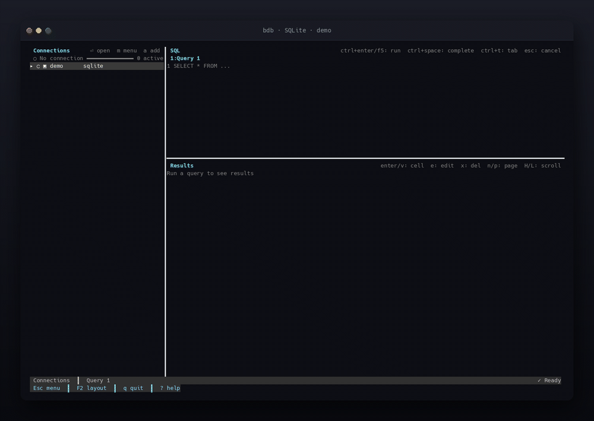
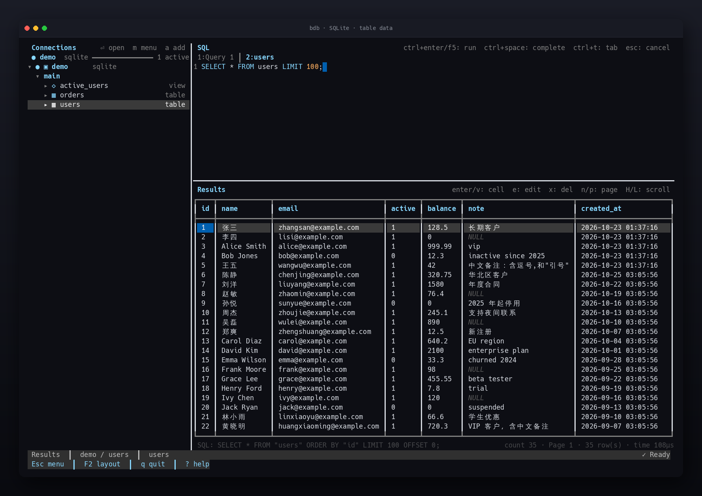
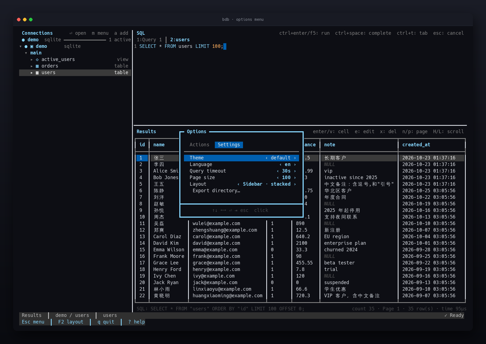
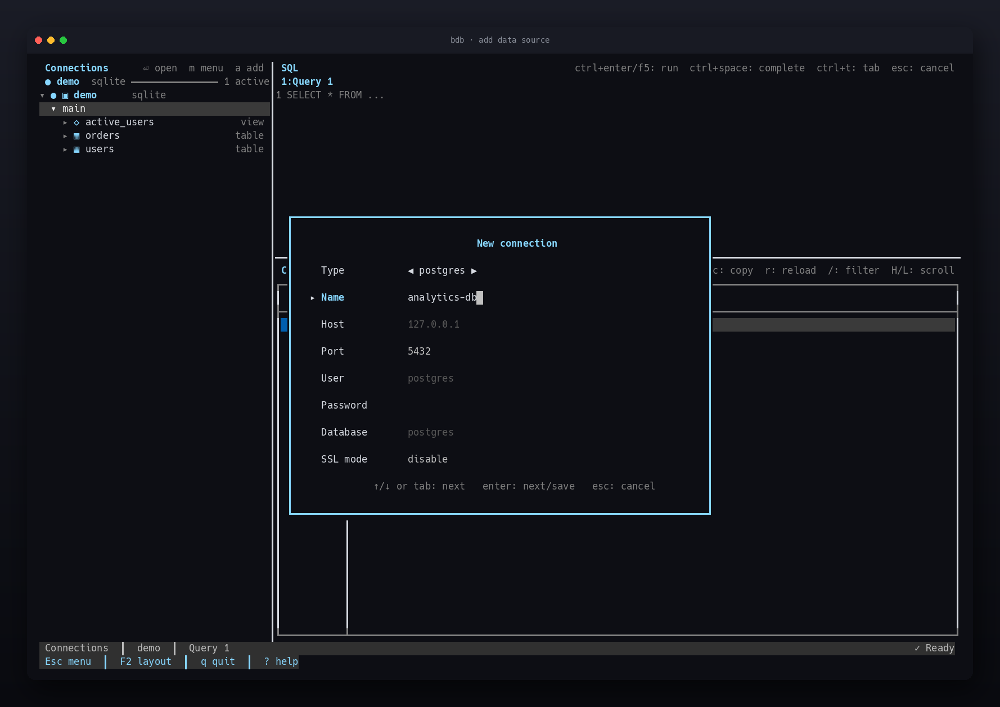
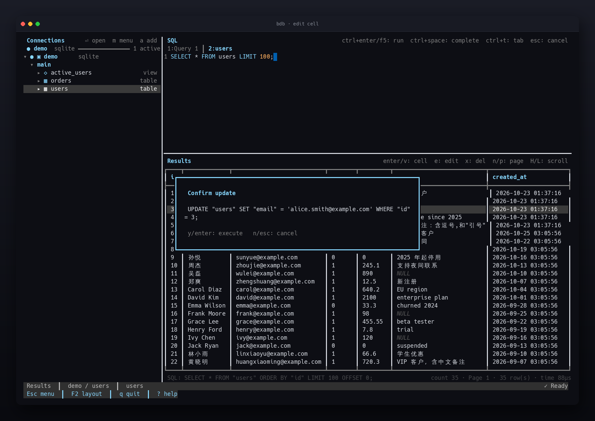
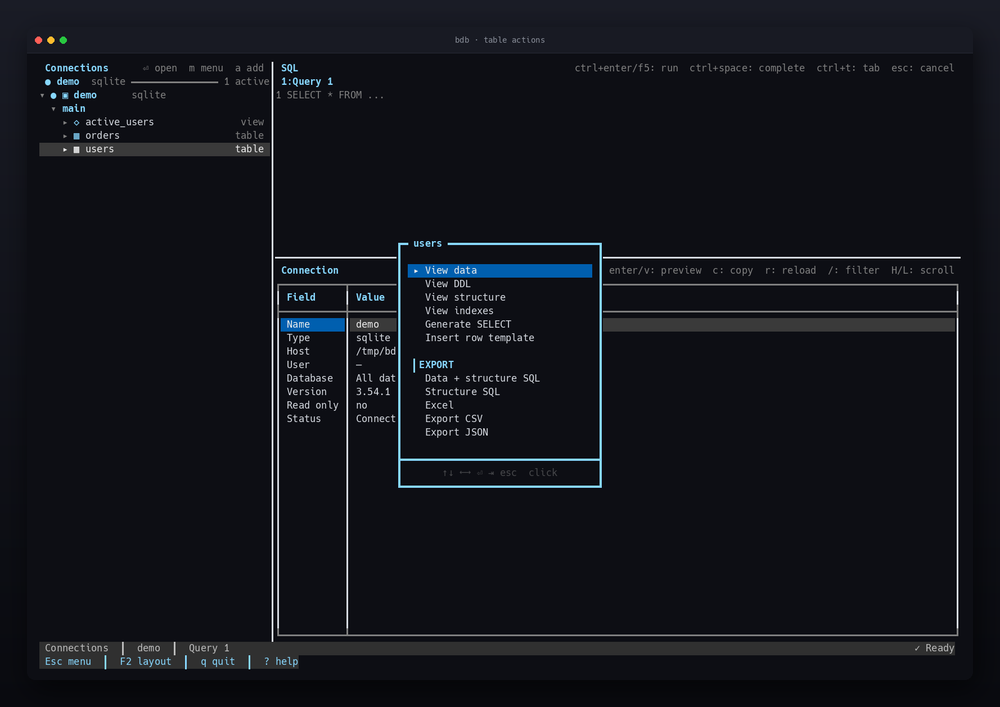
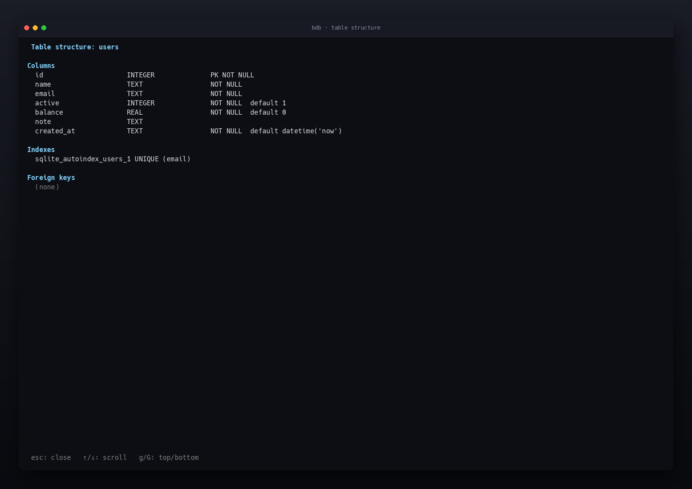
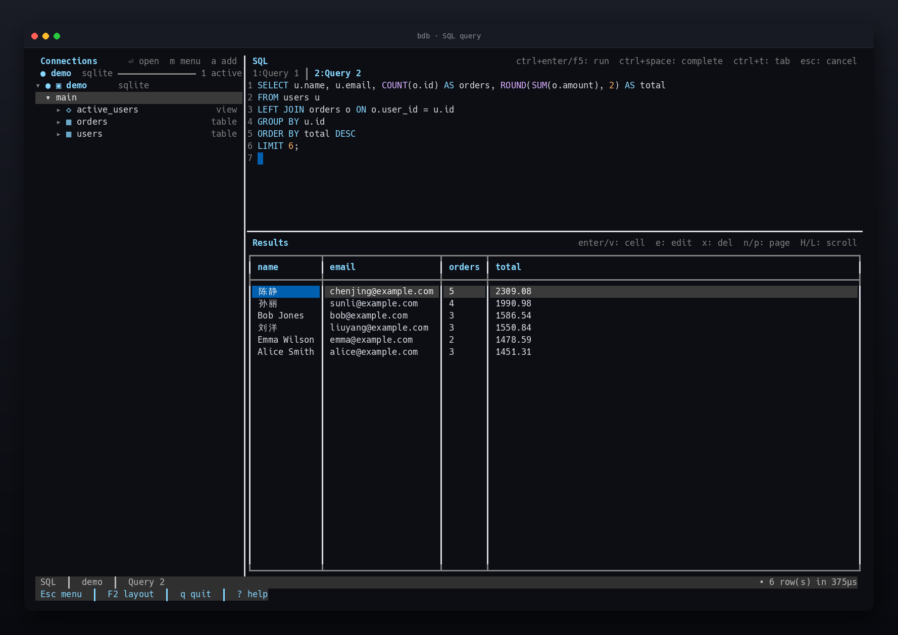
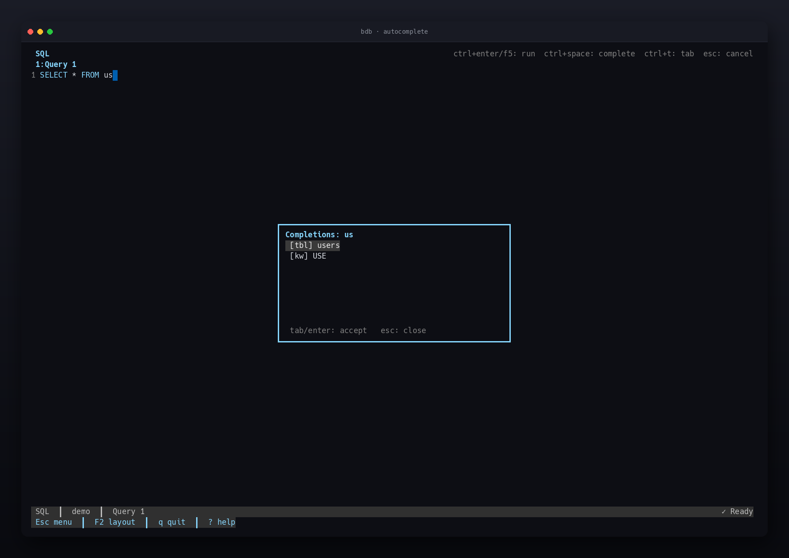
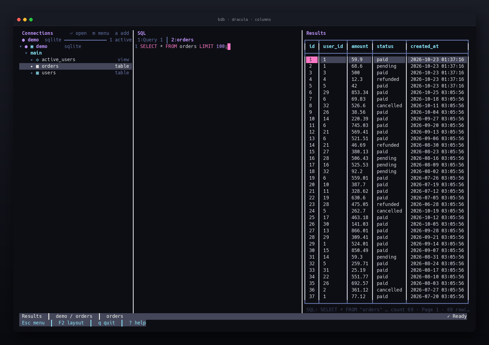

# bdb

**English** | [简体中文](README.zh.md)

[](https://github.com/LinduanTof/b-db/actions/workflows/go.yml)
[](https://github.com/LinduanTof/b-db/releases)
[](go.mod)
[](LICENSE)

A modern database client for the Linux terminal, built with Go and [Bubble Tea v2](https://github.com/charmbracelet/bubbletea). It aims to keep connection management, schema browsing, SQL editing, data editing and export inside a single terminal window.

Implemented: PostgreSQL/MySQL/SQLite browsing and queries, transactional cell editing and row insertion, CSV/JSON import, schema management (create/drop/alter tables and indexes), Redis/MongoDB, multiple sessions, table structure/DDL/indexes, CSV/JSON/Markdown export, SQL file execution, query history, 6 themes, SQL syntax highlighting and autocomplete, in-editor find, EXPLAIN plans, result filtering, focus layouts and mouse support.

## Screenshots





Browse databases and tables in the sidebar, write SQL in the editor and inspect editable results. Each section below includes a screenshot taken from a real run.

## How bdb compares

bdb focuses on breadth (SQL and NoSQL in one TUI), safe edits and zero-dependency distribution.

| Database | bdb | [lazysql](https://github.com/jorgerojas26/lazysql) | [rainfrog](https://github.com/achristmascarl/rainfrog) | [harlequin](https://github.com/tconbeer/harlequin) | [dblab](https://github.com/danvergara/dblab) |
|---|:-:|:-:|:-:|:-:|:-:|
| PostgreSQL | ✅ | ✅ | ✅ | ✅ | ✅ |
| MySQL / MariaDB | ✅ | ✅ | ✅ | ✅ | ✅ |
| SQLite | ✅ | ✅ | ✅ | ✅ | ✅ |
| Redis | ✅ | – | – | – | – |
| MongoDB | ✅ | – | – | – | – |
| Oracle | – | – | ✅ | – | ✅ |
| SQL Server | – | ✅ | – | ✅ | ✅ |
| DuckDB / Snowflake | – | – | – | ✅ | – |

What bdb adds on top of the basics:

- **One binary, five databases**: SQL and NoSQL sessions share the same editor, result grid and history.
- **Safe cell editing**: `UPDATE`/`DELETE` previews plus transactional execution that must touch exactly one row.
- **Four export formats**: streamed SQL, Excel, CSV and JSON; database-level export writes one file per table without loading it into memory.
- **Terminal-native UX**: 6 themes, focus layouts, mouse support, CJK-aware layout and an English/Chinese UI.

*Database coverage was checked against each project's public documentation in October 2026; see their docs for the latest.*

## Installation

### Homebrew (Linux)

```bash
brew install LinduanTof/tap/bdb
```

Every [release](https://github.com/LinduanTof/b-db/releases) also ships prebuilt binaries.

### Arch Linux (AUR)

PKGBUILDs for `bdb-bin` (prebuilt) and `bdb` (built from source) live in [`packaging/aur`](packaging/aur); see the README there for publishing to the AUR.

### go install

Go 1.26+ is required.

```bash
go install github.com/LinduanTof/b-db/cmd/bdb@latest
```

Pin a specific version:

```bash
go install github.com/LinduanTof/b-db/cmd/bdb@v0.3.0
```

The binary is installed to `$(go env GOPATH)/bin` (or `GOBIN` when set). Make sure it is on your `PATH`:

```bash
export PATH="$(go env GOPATH)/bin:$PATH"
bdb --version
```

### Build from source

```bash
make demo-db     # generate the SQLite demo database at testdata/demo.db
make build       # writes bin/bdb
```

## Quick start

```bash
bdb --config config.example.yaml            # binary installed with go install
./bin/bdb --config config.example.yaml      # binary built from source
```

The default config path is `$XDG_CONFIG_HOME/bdb/config.yaml` (usually `~/.config/bdb/config.yaml`); override it with `--config`. On first launch a commented default template is created with mode `0600` when the file does not exist. Existing files are never overwritten.

Minimal configuration:

```yaml
ui:
  language: auto          # auto | en | zh
  theme: default          # default | dracula | gruvbox | nord | catppuccin | solarized-light
  focus_mode: manual      # manual | auto
  layout: stacked         # stacked | columns | results-top
  export_dir: ""          # export directory; empty means the working directory
query:
  timeout: 30s            # unlimited disables the client-side timeout
  max_rows: 1000          # rows per page for table browsing; editor queries are unlimited
connections:
  - name: local
    type: sqlite
    path: ./testdata/demo.db
  - name: pg
    type: postgres
    host: 127.0.0.1
    port: 5432
    user: postgres
    password: ${PG_PASSWORD}
    database: postgres
    sslmode: disable
  - name: mysql
    type: mysql
    host: 127.0.0.1
    port: 3306
    user: bdb
    password: ${MYSQL_PASSWORD}
    database: bdb
```

Fields such as `password` support `${ENV_VAR}` references. A missing variable is reported at startup with the connection name and field instead of silently becoming an empty string. `chmod 600` the config file. PostgreSQL `database` may be omitted; bdb then connects to `postgres` and still lists every database in the sidebar. Setting `query.timeout` to `unlimited` (or choosing "Unlimited" in the `Esc` options menu) disables the client-side query timeout and leaves cancellation manual; the connection timeout stays at 10 seconds.

## Keyboard shortcuts

| Scope | Key | Action |
|---|---|---|
| Global | `Esc` | Open the options menu; cancels the running query |
| Global | `F2` | Toggle the focused layout (active pane fills the window) |
| Global | `Ctrl+Shift+W` / `Alt+W` | Close the current database session, keeping the others |
| Global | `q` | Quit (types a character while the editor has focus) |
| Global | `?` | Open the keyboard help |
| Global | `Tab` / `Shift+Tab` | Cycle panes |
| Global | `Ctrl+C` | Quit |
| Sidebar | `↑` / `↓` | Move the cursor |
| Sidebar | `Enter` | Connect, expand a node; a table node opens the table (new or reused tab); a connected root shows connection info |
| Sidebar | `→` / `←` | Expand / collapse |
| Sidebar | `m` | Open the node actions menu (connection, database, table) |
| Sidebar | `s` | Preview table data without touching the editor |
| Sidebar | `o` | Open the table in the editor without running it |
| Sidebar | `d` | Show the table structure (columns/indexes/foreign keys) |
| Sidebar | `a` | Add a data source (sidebar/results focus) |
| Sidebar | `r` | Reload the current node |
| Editor | `Ctrl+Enter` / `F5` | Run SQL |
| Editor | `Ctrl+T` | New SQL tab |
| Editor | `Ctrl+W` | Close the current SQL tab (the last tab cannot be closed) |
| Editor | `Ctrl+Tab` / `Ctrl+Shift+Tab` | Next / previous tab |
| Editor | `Alt+←` / `Alt+→` | Switch tabs (for terminals without `Ctrl+Tab`) |
| Editor | `Ctrl+Space` | Trigger SQL completion manually |
| Editor | `Ctrl+F` | Find in the editor (`Enter`/`↓` next, `Shift+Enter`/`↑` previous, `Esc` close) |
| Editor | `Alt+E` | Show the `EXPLAIN` plan for the first statement |
| Editor | `Ctrl+P` / `Ctrl+N` | Query history |
| Editor | `Esc` | Cancel the running query |
| Results | Arrows / `hjkl` | Move between cells |
| Results | `n` / `p` | Next / previous page (table data paging) |
| Results | `PgUp` / `PgDn` | Page up / down |
| Results | `g` / `G` | First / last row |
| Results | `H` / `L` | Scroll one screen of columns left / right |
| Results | `Enter` / `v` | View the full content of the current cell |
| Results | `e` | Edit the current cell |
| Results | `x` | Delete the current row |
| Results | `[` / `]` | Shrink / grow the current column |
| Results | `o` / `O` | Sort by the current column (asc/desc) / clear the sort |
| Results | `r` | Reload the table overview for the current database |
| Results | `/` | Filter the table overview or the current result rows |
| Results | `c` | Copy the current cell (OSC 52) |
| Results | `Ctrl+E` / `Ctrl+J` / `Ctrl+M` | Export CSV / JSON / Markdown |

> Most terminals cannot distinguish `Ctrl+Enter` from `Enter`. bdb requests the Kitty keyboard protocol; use `F5` when the terminal does not support it.

## Options menu

Press `Esc` to open the btop-style options menu while the main UI stays visible in the background:

- `↑`/`↓` move, `←`/`→` change a setting, `Enter` performs an action, `Esc` closes
- `Tab` / `Shift+Tab` switch between the **Actions** and **Settings** tabs; the tabs can also be clicked
- Heavy borders, a title embedded in the top border, tabs and a full-width cursor for the selection
- Actions: add data source, disconnect, help, quit
- Settings: theme, UI language, query timeout (including unlimited), rows per page, layout and export directory; changes apply immediately
- Use `Ctrl+E` / `Ctrl+J` / `Ctrl+M` in the results pane to export the current result; export is not duplicated in the menu
- The bottom bar always shows `Esc menu`, `q quit` and `? help`

Pressing `q` while the menu is open quits.



*The Settings tab covers theme, language, timeout, page size, layout and export directory; every change applies immediately.*

## Running SQL files

A script passed on the command line runs automatically after connecting to the default connection, and the last query's result appears in the results pane:

```bash
./bin/bdb --config config.yaml ./migrations/001_init.sql
```

Statements are split on semicolons with awareness of single-quoted, double-quoted and backtick strings, `--` and `/* */` comments; MySQL additionally supports `#` comments and `DELIMITER`, and PostgreSQL supports `$tag$...$tag$` dollar-quoting while keeping the `#` operator. The first failing statement stops the run and reports its index. Press `Esc` to cancel while it is running.

## Adding data sources

Press `a` in the sidebar or results pane, or choose "Add data source" in the options menu, to open the centered connection form. Use `←`/`→` to pick PostgreSQL, MySQL, SQLite, Redis or MongoDB, `↑`/`↓` or `Tab` to move between fields, `Enter` on the last field to save and `Esc` to cancel.

- Password fields are masked; `${ENV_VAR}` references are also accepted.
- Saving connects immediately and the new source appears in the sidebar.
- Runtime connections are stored in `$XDG_STATE_HOME/bdb/connections.yaml` (mode `0600`) and merged with the main config at startup; duplicate names are skipped.
- Fields change with the type: SQLite only needs a name and path; MySQL needs no database name (like Navicat); Redis asks for address, password and database number; MongoDB asks for a connection URI.
- The form is centered with fixed-width, left-aligned labels; the active field is marked with `▸` and the footer shows the available keys.



*Fields adapt to the selected type, passwords are masked, and saving connects and adds the source to the sidebar.*

## Layout

- `stacked` (default): sidebar plus editor above results
- `columns`: sidebar, editor and results side by side; falls back to `stacked` on narrow terminals
- `results-top`: sidebar plus results above the editor
- Switch it under "Layout" in the `Esc` options menu; the choice applies immediately and is remembered. `ui.layout` sets the default.

## Focus mode

- `F2` makes the focused pane fill the main area; press again to restore
- In focus mode `Tab` still cycles the three full-screen panes
- The sidebar can also be focused, which helps with large schemas
- With `ui.focus_mode: auto` the editor and results follow focus automatically and the three-pane layout returns when the sidebar is focused; `F2` then pauses or resumes auto focus
- "Toggle focused layout" is also available in the options menu

## Mouse

- Click a sidebar node to connect, expand or activate it
- With a menu open: the first click selects, a second click on the selected item performs the action or changes the setting; clicking a tab switches Actions/Settings, the wheel moves the selection, clicking outside closes the menu
- Table nodes: a single click selects, a double click opens the table (new or reused tab with paged data); use `m` for the node actions menu
- Click the editor to focus it and place the cursor, including on wrapped lines
- Click a result cell to select it
- The wheel scrolls the sidebar, editor, results grid and DDL/index viewers

## Sidebar session state

The sidebar header shows the current connection, its type and the number of active sessions, with status dots:

- `●`: current active connection
- `◉`: open but not currently displayed
- `○`: configured but not connected
- Connection names and database types are column-aligned; tables use `▦` and views use `◇`
- The sidebar header shows common shortcuts: `⏎` open, `m` table menu, `s` preview data, `d` structure, `r` reload, `a` add source, with labels when there is enough width
- `↑`/`↓` only move the cursor; `Enter` activates a node
- `m` opens actions for the selected node: connections offer connect/info/refresh/disconnect; databases offer open/refresh/close session; tables offer data preview, DDL, structure, indexes and generated SELECT
- Disconnecting closes every database session under that connection and collapses the list; closing a session collapses its database node
- Activating a connection root shows connection info (host, user, database, server version, read-only, status); activating a database node shows the table overview (table, type, estimated rows, size, column count, comment). Press `r` to refresh and `/` to filter. The overview selects whole rows; `Enter` or `v` previews the selected table. PostgreSQL/SQLite also show a Schema column, while MySQL/MongoDB do not repeat the database name
- PostgreSQL, MySQL and MongoDB list every database under the connection; each database is its own session
- PostgreSQL nests schemas above tables; MySQL/MongoDB list tables or collections directly under the database
- Database lists survive switching to another connection; clicking the connection root only expands or collapses the list and shows connection info, while clicking a database connects and switches to it
- Switching sessions restores the previous pane content, overview filter and sidebar cursor; returning to a session parked on the overview reloads the table list
- SQLite uses `main` as the top-level schema; Redis still browses db → key
- Expanded nodes use `▸` / `▾`, column rows use `·`

## Results grid

- With many columns, `←`/`→` scrolls horizontally; `H`/`L` scroll a full screen of columns and `Home`/`End` jump to the first/last column
- Long values are truncated in place; press `Enter` or `v` for the full-content viewer
- The viewer scrolls with `↑`/`↓`, `PgUp`/`PgDn`, `g`/`G`; close with `Esc` or `q`
- `[`/`]` resize the current column, `o`/`O` sort and `c` copies a cell; exports follow the current sort
- Table data opened with "View data" supports server-side paging: `n` loads the next page, `p` the previous one. The page size comes from `query.max_rows`; tables with a primary key are ordered stably by it
- A dim footer under the grid shows the SQL, total rows, page number, rows on the page and query time; when space is tight the SQL is truncated first
- Paging runs only in the results pane and never touches the editor; editing or deleting a cell reloads the current page without jumping back to page one
- Client-side sorting (`o`/`O`) only applies to the current page; in table previews `o`/`O` re-queries with an `ORDER BY` so the sort covers every page and returns to the first page
- `/` filters the current result in place: every column is matched case-insensitively, the footer shows `visible/total` and exports only include visible rows
- Row counts and sizes in the table overview are estimates (PostgreSQL `reltuples`/`pg_total_relation_size`, MySQL `information_schema`); comments come from `obj_description`/`TABLE_COMMENT`. Unavailable values show `-`, and SQLite, Redis and MongoDB do not provide rows, size or comments

## Exporting tables and databases

Press `m` on a table or database node; the Export group offers five formats:

- Data and schema SQL: `CREATE` DDL plus row-by-row `INSERT`s that rebuild the table
- Schema SQL: DDL only
- Excel (`.xlsx`): one worksheet for a table, one worksheet per table for a database
- CSV: a single file for a table; a directory with one file per table for a database
- JSON: an array of objects for a table; `{ "schema.table": [...] }` for a database

Files are written to the export directory, which defaults to the working directory at startup. Change it under "Export directory" in the `Esc` options menu: enter an absolute or relative path (relative to the working directory) or leave it empty to reset; missing directories are created. The choice is stored in `$XDG_STATE_HOME/bdb/export_dir` and `ui.export_dir` sets the default. Files are named `bdb-<name>-<timestamp>.<ext>`. Exports stream rows with a forward cursor, so memory use is independent of table size. The status bar shows the current table and progress (table count for database exports, row counts every 100k rows for a table), then the path. The overall export timeout is 30 minutes. An Excel worksheet holds at most 1,048,575 rows; larger tables must use CSV or SQL. Exporting is available for PostgreSQL, MySQL and SQLite only; Redis and MongoDB nodes do not show Export.

## Editing data

Enabled only for results opened through the table actions menu's "View data" on a table with a primary key:

- `e` edits the current cell: enter a new value → preview the `UPDATE` → press `y`
- `x` deletes the current row: preview the `DELETE` → press `y`
- Writes run in a transaction and must affect exactly one row
- Editing or deleting in paged table data reloads the current page
- With `read_only: true` cell editing and write statements are blocked; bdb additionally rejects SQL `EXECUTE`, write-style SQLite `PRAGMA`s, all Redis commands except a conservative read-only allowlist (including `EVAL`/`FCALL`, `SETBIT`, `SORT ... STORE`) and MongoDB `$out`, `$merge`, `$where`, `$function` and `$accumulator`. This is a conservative client-side check; use a read-only database account or replica as the real boundary.
- "Insert row template" in the table actions menu generates an `INSERT` template in the editor
- "Insert row" in the table actions menu opens a form with one field per column. Empty fields are omitted so the column default applies, `NULL` writes a null and `''` writes an empty string. A single integer primary key may be left empty and is generated by the database. The `INSERT` is previewed and runs in a transaction that must affect exactly one row



*Press `e`, type the new value and press Enter to preview the full `UPDATE`; it runs in a transaction only after you confirm.*

## Importing data

Import is available from the table actions menu on PostgreSQL, MySQL and SQLite tables:

- Choose a CSV or JSON file, the format and whether the first CSV line is a header
- With a header, columns are matched by name (case-insensitive) and unknown columns are rejected; without one, fields map to the table columns in order
- Values are converted using the target column type; an empty CSV field becomes `NULL` and JSON `null` stays null
- The confirm box previews the mapped columns and the first five rows
- The import runs in a single transaction with a streaming reader, so a failure rolls everything back; progress is shown every 1,000 rows and `Esc` cancels it
- CSV is streamed; JSON is decoded fully, so prefer CSV for very large files
- A `read_only: true` connection rejects imports

## Schema changes

Select a table in the sidebar, press `m` and choose **Manage**:

- Drop table, truncate table, rename table
- Add column (name, type, nullable, default) and drop column (picked from the column list)
- Create index (name, columns, unique) and drop index (picked from the index list)

Select a database node and choose **Create table** to create a table from a name plus a column-definition body such as `id INTEGER PRIMARY KEY, name TEXT`.

Every change shows the generated SQL in a confirm box and runs only after `y`. SQLite truncates with `DELETE FROM`. Schema changes are rejected on `read_only` connections and are only offered for PostgreSQL, MySQL and SQLite.

## Redis and MongoDB

Redis:

- The sidebar browses db → key (SCAN, up to 500 keys)
- "View data" generates `GET` / `HGETALL` / `LRANGE` / `SMEMBERS` / `ZRANGE` / `XRANGE` based on the key type
- The editor accepts Redis commands such as `SCAN 0 COUNT 50` and `GET "my key"`

MongoDB:

- The sidebar browses database → collection
- Editor query syntax:
  - `find <db>.<collection> [json]`
  - `findOne <db>.<collection> [json]`
  - `aggregate <db>.<collection> [json array]`
  - `count <db>.<collection> [json]`
- "View data" generates `find db.collection {}`

## Multiple sessions

Every connection keeps its own editor content, results grid, completion and edit caches. Switching to another configured connection saves the current state and restores it when you return; disconnecting does not affect other sessions.

SQL tabs are also isolated per connection: each session keeps its own tab list and active tab. Tab contents are persisted to `$XDG_STATE_HOME/bdb/editor_tabs.yaml` and restored after a restart when you connect again.

Closing sessions:

- `Esc` → "Close current session" releases only the current database session
- `Ctrl+Shift+W` or `Alt+W` closes the current session directly
- Switching connections or databases never closes sessions; it only saves state
- `q` or `Ctrl+C` closes every session and connection

## Table actions menu

Select a table in the sidebar and press `Enter` to open it:

- **View data**: browse the table with `query.max_rows` paging without touching the editor; use `n`/`p` in the results pane
- **View DDL**: show the `CREATE TABLE` statement (MySQL uses `SHOW CREATE TABLE`, SQLite reads `sqlite_master`, PostgreSQL builds it from the catalog)
- **View structure**: columns, indexes and foreign keys
- **View indexes**: the index list
- **Generate SELECT**: fill the editor with a query without running it
- **Insert row**: open a form with one field per column and insert a single row (SQL tables only)
- **Import data**: load CSV or JSON rows into the table (SQL tables only)
- **Manage**: drop, truncate or rename the table, add or drop columns, and create or drop indexes (SQL tables only)

DDL and index viewers scroll with `↑`/`↓`, `PgUp`/`PgDn`, `g`/`G` and close with `Esc` or `q`.



*The table actions menu offers data preview, DDL, structure, indexes, generated SELECT, row insertion, import, schema management, an insert template and SQL/Excel/CSV/JSON export.*



*"View structure" lists column types, primary keys, nullability, defaults, indexes and foreign keys, with `g`/`G` to jump.*

## SQL editor

The editor colors SQL using the current theme: keywords, functions, strings, numbers and comments each get their own color. It supports multi-line editing, line numbers, `Ctrl+Space` completion, query history, incremental find (`Ctrl+F`) and query plans. Long lines wrap at the pane width instead of being truncated; continuation rows keep the line-number gutter aligned.

- `Ctrl+F` opens the find prompt in the editor's hint line; matches are highlighted as you type, `Enter`/`↓` and `Shift+Enter`/`↑` cycle through them and `Esc` closes the prompt
- `Alt+E` runs the first statement in the editor through `EXPLAIN (FORMAT TEXT)` on PostgreSQL, `EXPLAIN` on MySQL and `EXPLAIN QUERY PLAN` on SQLite. It never uses `ANALYZE`, so write statements are not executed

Editor queries have no row limit and load their results into memory at once; add `LIMIT` yourself for large tables. `query.max_rows` only controls table-data paging.



*Keywords, strings, numbers and comments are colored; run with `F5` or `Ctrl+Enter` and sort, copy or export from the results grid.*

## Status bar

- The left side shows the current pane, breadcrumb and active SQL tab, e.g. `Results │ local-sqlite / users │ Query 1`
- The breadcrumb is `connection / database / schema.table`, extending to the table when table data or an editor tab comes from one
- The current connection, its type and the active session count appear at the top of the sidebar
- The right side shows an icon status: `✓ Ready`, `… Running`, `✗ error`
- Paging details live in the results footer rather than the status bar
- The bottom line keeps shortcuts such as `Esc`, `F2`, `q` and `?`

## Tabs and autosave

- Every connection owns a separate set of SQL tabs
- `Ctrl+T` opens, `Ctrl+W` closes, `Ctrl+Tab` / `Ctrl+Shift+Tab` or `Alt+←/→` switch
- Tab contents, titles and the active tab are saved to `$XDG_STATE_HOME/bdb/editor_tabs.yaml` (mode `0600`) and restored after a restart
- The last tab cannot be closed, so the editor always has one

## SQL autocomplete

Completion pops up while you type identifiers and can be triggered with `Ctrl+Space`. Candidates include SQL keywords, common functions, every table in the current connection and loaded column names; typing `users.` loads that table's columns on demand. Use `↑`/`↓` to select, `Tab` or `Enter` to accept and `Esc` to close.



*Inside the focused layout (`F2`), `Ctrl+Space` shows candidates tagged by source (table, keyword).*

## Themes

Six themes ship with bdb: `default`, `dracula`, `gruvbox`, `nord`, `catppuccin` and `solarized-light`. Set `ui.theme` in the config or switch with `←`/`→` in the `Esc` options menu. The runtime choice is written to `$XDG_STATE_HOME/bdb/theme` and restored on the next launch; that state file wins over `ui.theme`, so delete it to go back to the configured theme.



*The `dracula` theme with the `columns` layout: sidebar, editor and results side by side, falling back to `stacked` on narrow terminals.*

## Query history

Successfully executed statements are persisted to `$XDG_STATE_HOME/bdb/history` (default `~/.local/state/bdb/history`) with mode `0600`, keeping the latest 500 entries. Browse them in the editor with `Ctrl+P` / `Ctrl+N`.

## Development

Branching:

- `main` only accepts merges, no direct commits
- Day-to-day work happens on `dev`

```bash
make test        # generate demo.db and run the full test suite
make vet
go test ./...
```

PostgreSQL / MySQL integration checks:

```bash
docker compose -f deploy/docker-compose.yml up -d
PGPASSWORD=bdb psql -h 127.0.0.1 -U bdb -d bdb
mysql -h 127.0.0.1 -ubdb -pbdb bdb
```

Override ports when they are taken: `BDB_PG_PORT=5433 BDB_MYSQL_PORT=3307 docker compose ... up -d`.

Benchmarks:

```bash
go test -bench . -benchmem ./internal/ui/results ./internal/ui/editor
```

Static releases:

```bash
make release          # dist/bdb-linux-amd64, arm64 and checksums.txt
goreleaser release --clean
```

## Roadmap

P2/P3/P4 are complete: transactional data editing, SQL syntax highlighting, Redis/MongoDB, multiple sessions, performance benchmarks and static releases.

Possible next steps: SSH tunnels, TLS, Redis/MongoDB writes, an insert-row form and more export formats.
